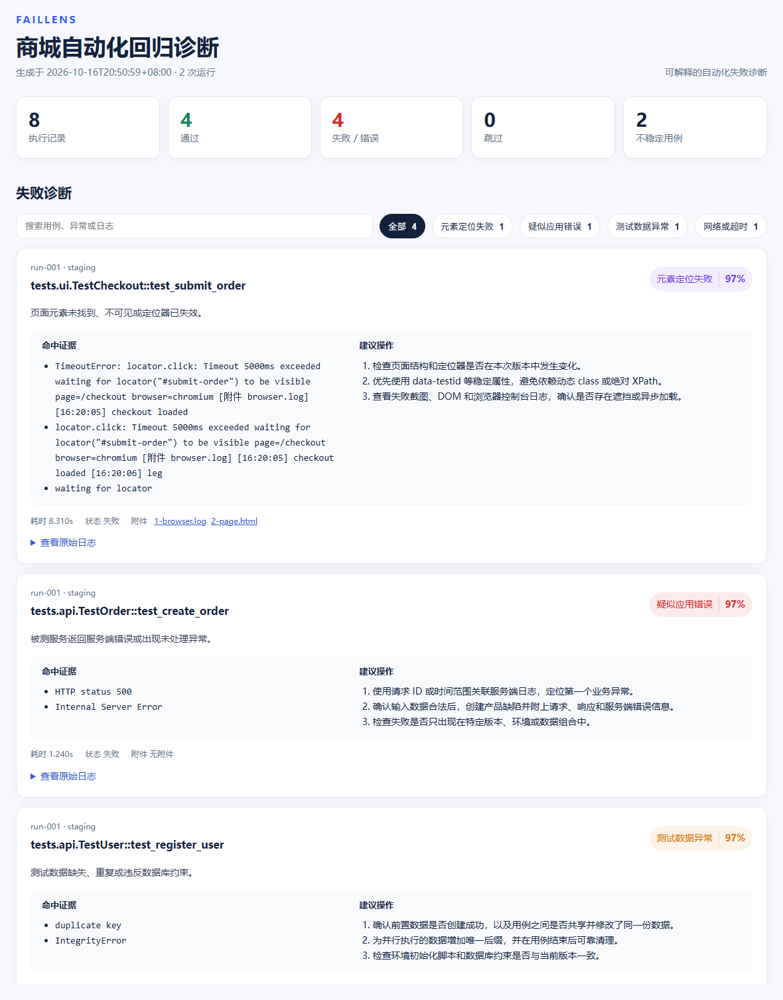

# FailLens

**可解释的自动化测试失败诊断与 Flaky 用例分析工具**

[](https://www.python.org/)
[](https://github.com/xiaoli50823/FailLens/actions/workflows/test.yml)
[](https://github.com/xiaoli50823/FailLens)
[](LICENSE)

FailLens 读取 Pytest / JUnit XML、异常堆栈与测试附件，自动识别常见失败原因，计算 flaky 指标，并生成可以离线打开的质量分析报告。

它的目标不是替测试人员下结论，而是把分散在堆栈、截图和历次运行里的线索整理成可解释、可行动的排查依据。


## 目录

- [为什么需要 FailLens](#为什么需要-faillens)
- [核心能力](#核心能力)
- [处理流程](#处理流程)
- [快速开始](#快速开始)
- [接入现有 Pytest 项目](#接入现有-pytest-项目)
- [命令行](#命令行)
- [诊断示例](#诊断示例)
- [失败诊断详情](#失败诊断详情)
- [稳定性指标](#稳定性指标)
- [项目结构](#项目结构)
- [测试](#测试)
- [设计边界](#设计边界)
- [后续计划](#后续计划)
- [License](#license)

## 为什么需要 FailLens

自动化流水线失败后，时间往往花在定位而不是执行：逐条翻堆栈、找截图、区分产品缺陷与环境问题、判断用例是不是偶发失败。FailLens 把这些步骤收敛到一份报告里：

- 按故障模式自动归类失败，并展示命中的原始日志证据
- 针对每类故障给出明确的排查建议，而不是只给一个结论标签
- 聚合同一用例的历次结果，识别通过 / 失败来回切换的 flaky 用例
- 关联截图、DOM、浏览器日志和网络日志等测试附件
- 输出单文件静态 HTML，不需要数据库，也不需要部署服务端

## 核心能力

| 能力 | 说明 |
| --- | --- |
| JUnit 解析 | 递归读取一个或多个 Pytest / JUnit XML 文件，并解析名称、状态、耗时与堆栈 |
| 失败诊断 | 基于可解释规则识别元素定位、网络超时、测试数据、测试环境、应用错误和断言失败 |
| 可解释评分 | 输出诊断类型、置信度、命中证据和排查建议，保留判断依据 |
| 稳定性分析 | 统计通过率、失败率、状态切换次数和 flaky 分数 |
| 附件关联 | 收集截图、DOM、日志与 JSON 附件，并让文本附件参与诊断 |
| 质量控制台 | 提供质量概览、失败诊断、稳定性分析、运行记录筛选和深色模式 |
| 工程集成 | 同时输出 HTML 与 JSON，可直接作为 Jenkins 或 GitHub Actions 构建产物 |

## 处理流程

```text
JUnit XML + run.json + 测试附件
                 |
                 v
        解析与标准化测试结果
                 |
        +--------+---------+
        |                  |
        v                  v
   诊断规则评分        历史结果聚合
        |                  |
        +--------+---------+
                 |
                 v
        HTML 控制台 + JSON 报告
```

## 快速开始

FailLens 运行时只依赖 Python 标准库，需要 Python 3.10 或更高版本，不需要安装第三方包。

```powershell
git clone https://github.com/xiaoli50823/FailLens.git
cd FailLens

python -m faillens analyze examples/runs `
  --output output/demo `
  --project "商城自动化质量中心"

python -m faillens serve output/demo --open
```

也可以直接打开生成的 `output/demo/report.html`，报告不依赖本地服务。

## 接入现有 Pytest 项目

先生成 JUnit XML，再交给 FailLens 分析：

```powershell
pytest --junitxml=test-results/run-001/junit.xml
python -m faillens analyze test-results --output output/latest
```

建议每次运行保留独立目录，便于对比历次结果和识别 flaky 用例：

```text
test-results/
  run-001/
    junit.xml
    run.json
    artifacts/
      test_submit_order/
        screenshot.png
        page.html
        browser.log
  run-002/
    junit.xml
    run.json
```

可选的 `run.json` 用于在报告中展示版本与环境信息；缺失时会退回到 XML 所在目录名推断运行标识：

```json
{
  "timestamp": "2026-10-16T09:30:00+08:00",
  "commit": "a1b2c3d",
  "branch": "main",
  "environment": "staging"
}
```

## 命令行

### 生成报告

```text
python -m faillens analyze INPUT [INPUT ...] --output OUTPUT_DIR

--project NAME       报告中的项目名称，默认「自动化测试诊断报告」
--min-confidence N   重点诊断的最低置信度，范围 0-1，默认 0.45
--no-artifacts       不复制截图、DOM 和日志附件
```

`INPUT` 可以是 XML 文件，也可以是包含 XML 的目录；传入多个输入时会合并分析，并在报告中区分不同运行。

### 本地预览

```text
python -m faillens serve REPORT_DIR [--host HOST] [--port PORT] [--open]

REPORT_DIR           报告目录，默认 output/faillens-report
--host HOST          监听地址，默认 127.0.0.1
--port PORT          监听端口，默认 8765
--open               启动后打开默认浏览器
```

预览服务默认只监听 `127.0.0.1`，不会把测试报告暴露到局域网。

## 诊断示例

输入日志：

```text
TimeoutError: locator.click: Timeout 5000ms exceeded
waiting for locator("#submit-order") to be visible
```

诊断结果：

```text
类型：元素定位失败
置信度：97%
证据：waiting for locator
建议：检查页面结构和定位器是否在本次版本中发生变化
```

结论、置信度、命中的原始证据和排查建议会一起给出，方便复核判断是否合理，而不是接受一个黑盒标签。

## 失败诊断详情

每条失败记录都会展开命中证据与建议操作，并附上耗时、状态和关联附件：



## 稳定性指标

| 指标 | 含义 |
| --- | --- |
| 通过率 | 通过用例数占已执行用例数的比例，跳过用例不计入分母 |
| 失败率 | 失败与错误用例数占已执行用例数的比例 |
| 状态切换 | 相邻两次运行状态发生变化的次数，用于衡量结果抖动 |
| flaky 用例 | 同一用例既有通过也有失败记录，即判定为 flaky |
| flaky 分数 | 由失败率均衡度与状态切换频率加权得到，取值 0-1，越大越不稳定 |

判定规则保持简单可解释：只有通过和失败同时出现才判定为 flaky，从未失败或从未通过的用例不会被误报。

## 项目结构

```text
faillens/
  cli.py                 命令行入口与本地预览服务
  junit.py               JUnit、运行元数据和附件解析
  diagnosis.py           可解释诊断规则与评分
  analyzer.py            历史聚合与 flaky 计算
  report.py              报告数据组装与文件生成
  models.py              数据模型
  templates/report.html  响应式质量控制台
examples/runs/           可直接运行的演示数据
tests/                   单元测试
docs/assets/             README 展示资源
```

## 测试

```powershell
python -m unittest discover -s tests -v
```

当前测试覆盖诊断规则、JUnit 解析、历史聚合、flaky 判定、附件读取以及 HTML / JSON 报告生成。CI 在 Python 3.10 与 3.12 上运行同一套测试，并在流水线中生成一份示例报告。


## 设计边界

FailLens 采用可解释规则评分。置信度表示日志证据与故障模式的匹配程度，不代表对产品缺陷的最终判定；分数高只说明证据一致，仍需要人确认。

工具不会上传测试数据，全部分析都在本地完成。报告是静态 HTML，可以随构建产物归档，也可以离线打开复查。

## 后续计划

- 支持自定义 YAML 诊断规则，减少修改代码的成本
- 增加 JUnit、Allure 与 Playwright 的原生适配器
- 对相似堆栈做失败聚类与去重，压缩重复噪声
- 补充 GitHub Actions 与 Jenkins 集成示例
- 增加基线对比与质量门禁配置

## License

本项目使用 [MIT License](LICENSE)。
