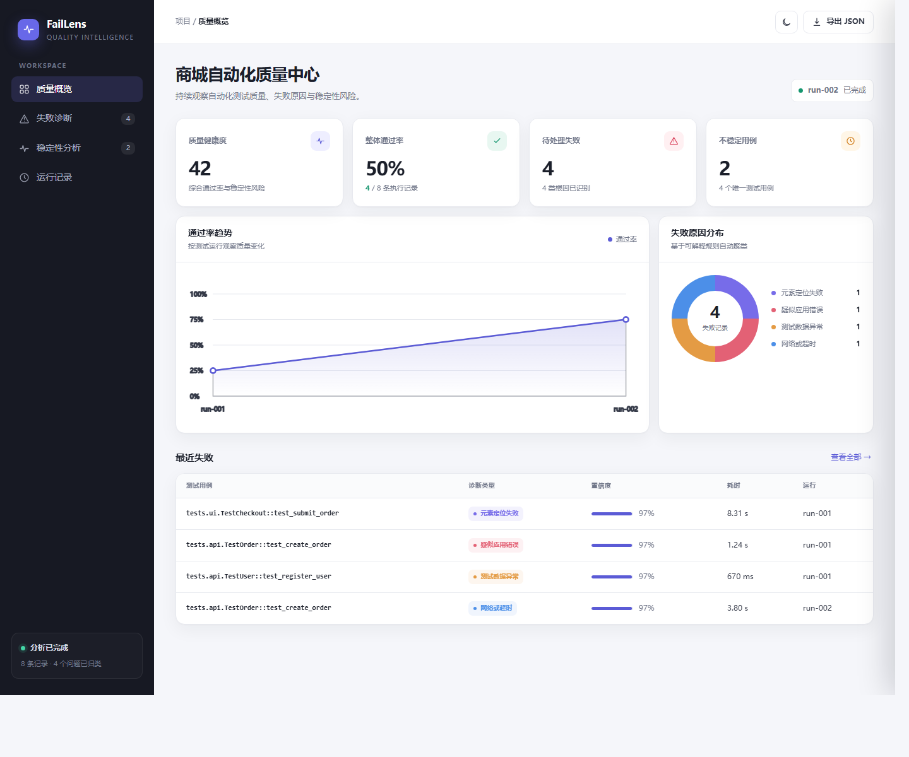

<div align="center">

# FailLens

可解释的自动化测试失败诊断与稳定性分析工具

[](https://www.python.org/)
[](https://github.com/)
[](LICENSE)

</div>

FailLens 读取 Pytest/JUnit XML、异常堆栈和测试附件，自动识别常见失败原因，计算 flaky 指标，并生成可离线查看的质量分析报告。它的目标不是替代测试人员判断，而是把分散的日志、截图和历史结果整理成可解释、可行动的排查线索。



## 为什么需要 FailLens

自动化流水线失败后，时间通常消耗在定位而不是执行：逐条查看堆栈、寻找截图、区分产品缺陷与环境问题、确认用例是否偶发失败。FailLens 将这些步骤集中到一份报告中：

- 将失败自动归类，并展示命中的原始证据
- 为每种故障类型提供明确的排查建议
- 聚合同一用例的历史结果，识别 flaky 用例
- 关联截图、DOM、浏览器日志和网络日志
- 使用静态 HTML 交付报告，无需部署数据库或服务端

## 核心能力

| 能力 | 说明 |
| --- | --- |
| JUnit 解析 | 递归读取一个或多个 Pytest/JUnit XML 文件 |
| 失败诊断 | 识别元素定位、网络超时、测试数据、环境、应用错误、断言失败和未知问题 |
| 可解释评分 | 输出诊断类型、置信度、命中证据和建议操作 |
| 稳定性分析 | 统计通过率、失败率、状态切换和 flaky 分数 |
| 附件关联 | 收集截图、DOM、日志和 JSON 文件，并让文本附件参与诊断 |
| 质量控制台 | 提供质量概览、失败诊断、稳定性分析、运行记录和深色模式 |
| 工程集成 | 输出 HTML 与 JSON，适合放入 Jenkins 或 GitHub Actions 构建产物 |

## 处理流程

```text
JUnit XML + run.json + 测试附件
                 |
                 v
        解析与标准化测试结果
                 |
        +--------+---------+
        |                  |
        v                  v
   诊断规则评分        历史结果聚合
        |                  |
        +--------+---------+
                 |
                 v
        HTML 控制台 + JSON 报告
```

## 快速开始

FailLens 的运行时仅依赖 Python 标准库，需要 Python 3.10 或更高版本。

```powershell
python -m faillens analyze examples/runs `
  --output output/demo `
  --project "商城自动化质量中心"

python -m faillens serve output/demo --open
```

也可以直接打开生成的 `output/demo/report.html`。

## 接入现有 Pytest 项目

先生成 JUnit XML：

```powershell
pytest --junitxml=test-results/run-001/junit.xml
python -m faillens analyze test-results --output output/latest
```

建议为每次运行保留独立目录：

```text
test-results/
  run-001/
    junit.xml
    run.json
    artifacts/
      test_submit_order/
        screenshot.png
        page.html
        browser.log
  run-002/
    junit.xml
    run.json
```

可选的 `run.json` 用于展示版本和环境信息：

```json
{
  "timestamp": "2026-10-16T09:30:00+08:00",
  "commit": "a1b2c3d",
  "branch": "main",
  "environment": "staging"
}
```

## 命令行

### 生成报告

```text
python -m faillens analyze INPUT [INPUT ...] --output OUTPUT_DIR

--project NAME       报告中的项目名称
--min-confidence N   重点诊断最低置信度，范围 0-1，默认 0.45
--no-artifacts       不复制测试附件
```

### 本地预览

```text
python -m faillens serve REPORT_DIR [--host HOST] [--port PORT] [--open]
```

默认仅监听 `127.0.0.1`，不会将测试报告暴露到局域网。

## 诊断示例

输入日志：

```text
TimeoutError: locator.click: Timeout 5000ms exceeded
waiting for locator("#submit-order") to be visible
```

诊断结果：

```text
类型：元素定位失败
置信度：97%
证据：waiting for locator
建议：检查页面结构变化，并优先使用 data-testid 等稳定属性
```

## 项目结构

```text
faillens/
  cli.py                 命令行入口和本地预览服务
  junit.py               JUnit、运行元数据和附件解析
  diagnosis.py           可解释的诊断规则与评分
  analyzer.py            历史聚合与 flaky 计算
  report.py              报告数据组装与文件生成
  templates/report.html  响应式质量控制台
examples/runs/           可直接运行的演示数据
tests/                   单元测试
docs/assets/             README 展示资源
```

## 测试

```powershell
python -m unittest discover -s tests -v
```

当前测试覆盖诊断规则、JUnit 解析、历史聚合、flaky 判断、附件读取以及 HTML/JSON 报告生成。

## 设计边界

FailLens 采用可解释规则评分。置信度表示日志证据与故障模式的匹配程度，不代表对产品缺陷的最终判定。工具不会上传测试数据，所有分析均在本地完成。

## 后续计划

- 支持自定义 YAML 诊断规则
- 增加 JUnit、Allure 与 Playwright 原生适配器
- 对相似堆栈进行失败聚类和去重
- 提供 GitHub Actions 与 Jenkins 集成示例
- 增加基线对比和质量门禁配置

## License

本项目使用 [MIT License](LICENSE)。
